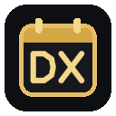
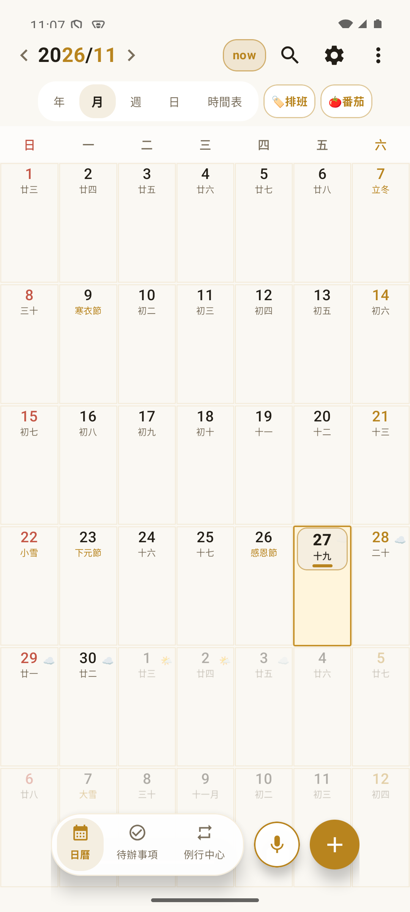
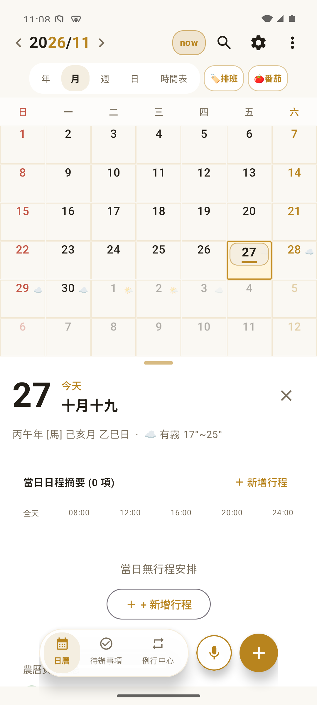
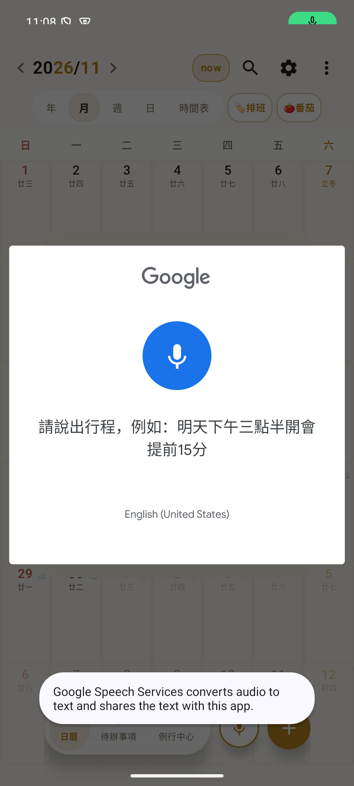
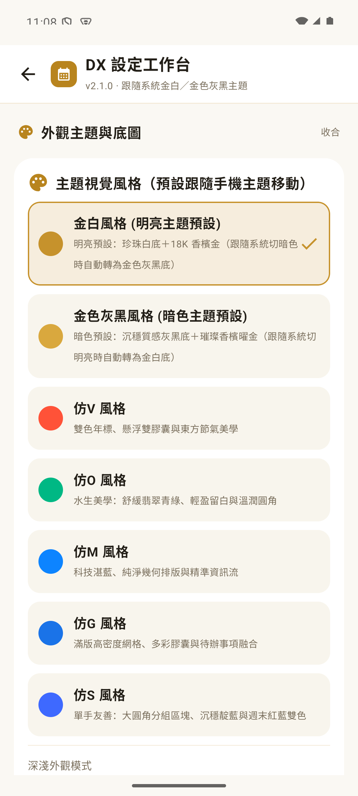

# DX日曆 (DX-Calendar)

  

  <b>奢華金白／金色灰黑跨裝置全能日曆 · 手機・摺疊機・平板・Chrome 桌面無縫聯動</b> 
  <a href="#繁體中文">繁體中文</a> ·
  <a href="#简体中文">简体中文</a> ·
  <a href="#english">English</a> ·
  <a href="#日本語">日本語</a>

---

## 📲 Google Play 測試與下載（三步驟連結）

> ⚠️ **重要提示**：加入 Google 測試群組後，Google Play 系統採**批量授予測試權限**，約需等待 **10 分鐘 ～ 3 小時** 才會生效。若點擊「申請測試」或「下載連結」時顯示尚未開放，**建議稍等一段時間再回來點擊即可正常下載**！  
> ⚠️ **Important Note**: After joining the Google Group, Google Play grants tester access in batches (typically **10 minutes to 3 hours**). If the opt-in or download page isn't available yet, please wait a while and try again.

| 步驟 / Step | 操作說明 | 連結 / Link |
| :---: | :--- | :--- |
| **1** | **加入 DX Google 測試群組**（點擊「加入群組」/ Join Group） | 👉 https://groups.google.com/g/dx-file-manager-testers |
| **2** | **申請成為 Google Play 測試人員**（加入群組後請等候 10 分鐘～3 小時再點「成為測試人員」） | 👉 https://play.google.com/apps/testing/com.dx.calendar |
| **3** | **前往 Google Play 商店下載 DX日曆**（授權生效後即可下載與自動更新） | 👉 https://play.google.com/store/apps/details?id=com.dx.calendar |

---

## 🎬 模擬器實機展示圖片與操作影片（36 秒全功能演示）

> 🎥 **完整 36 秒操作示範影片**：點擊觀看或下載 [docs/media/dx-calendar-demo.mp4](docs/media/dx-calendar-demo.mp4)（展示金白主題月曆、左右滑動換月、手機上滑手勢壓縮月曆與當日時間表、離線語音快記與設定工作台）

  
  
  
  

---

## 🇹🇼 繁體中文｜全功能介紹、免費與付費方案

### ✨ 核心特色功能總覽
1. **高顏值美學與全裝置免費適配**：
   - 內建 **金白風格（明亮主題預設）** 與 **金色灰黑風格（暗色主題預設）**，預設自動跟隨手機系統深淺色切換；另提供 **仿 V／仿 O／仿 M／仿 G／仿 S** 多套風格與自訂月曆底圖透明度。
   - **多裝置體驗一律免費**：手機單欄（支援仿三星上滑手勢壓縮月曆並於各日期下方疊加事件色條、設定頁獨立開關預設開啟）、摺疊機展開左右雙欄、8 吋／10 吋平板三欄＋鍵盤快捷鍵、以及電腦端 Chrome 瀏覽器擴充功能，全部免費提供！
2. **在地農曆節氣與進階日曆檢視**：
   - **其他曆法預設依所在地自動選取**（例如台灣自動套用「台灣農曆」，另支援中國農曆、香港農曆與關閉），搭配二十四節氣、國定假日、傳統節日獨立管理、時區優先、雙時區對照、一週起始日（區域預設／週日／週一）與 7 天月曆天氣。
3. **5 款原生向量超清桌面小工具**：
   - 全面升級 100% 原生 Android 向量 `TextView` 渲染，字體清晰度追平系統原生：支援 **DX 月曆（60fps 單週展開動畫、常駐 `now`、0–100% 透明度）**、**DX 時間表**、**下一行程＋天氣 (4×1)**、**倒數日＋天氣 (2×2)**、**單週 7 天天氣＋行程 (4×2)**。
4. **跨生態雙向同步與智慧輸入**：
   - 支援**多組 Gmail 帳號**與 Google 日曆雙向同步（點入直接編輯／刪除、真實提醒分鐘數同步、**Gemini 語音助理新增行程即時聯動**）。
   - **Google Tasks** 排於各 Gmail 帳號最下方（官方藍色打勾圖示、支援時刻辨識與補設時間、一鍵直開 Google Tasks App）。
   - **個人 LINE 智慧聯動**：免 API 零費用，透過「分享 → 加入 DX日曆」、選字「加入 DX日曆」或剪貼簿貼上多行通知自動擷取標題、時間、地點與連結；另支援**離線語音快記**、**輪班排班一鍵連點**、**長按跨日改期**、**番茄鐘**與**聯絡人生日自動匯入**。
5. **精準強提醒、吃藥例行與專屬隱私**：
   - 通知跳出完整帶出 **`📅 事件名稱 · 時間`** 與 **`☑️ 任務名稱 · 時間`**，支援 **Android 16 動態島／原子島通知**、**多重連段追擊鬧鐘**、**全螢幕鬧鐘強提醒**、**自訂「幾天幾時幾分前」多組提醒**、**隔 N 週重複＋提早通知**，並嚴格遵守「日曆預設不提示」規則。
   - 新增事件頁內建 **「啟用吃藥／例行提醒」** 開關（自動展開重複週期、服藥快捷時段與不塞爆月曆選項）；設定頁提供 **🌸 女性健康（8 組追蹤範本＋臨時專屬檢視，預設關閉）** 與設定最底部的 **雙指紋加密隱私日曆**，以及 Google Drive 完整雲端備份還原。

### 💎 免費版 vs DX Pro 方案說明（台幣 NT\$ 基準）

> 🎁 **前 7 天全功能免費體驗（無廣告）**：首次安裝立即享 **7 天完整 DX Pro 體驗**，免費期間 **100% 不會出現任何廣告**！  
> 🛡️ **低干擾廣告原則**：免費期結束後僅於設定頁底部顯示低干擾橫幅廣告（**絕無開屏廣告、絕無插頁廣告、絕無桌面小工具廣告**），並可隨時 **看 1 支短廣告免費解鎖 24 小時無廣告＋全功能 Pro**！  
> 🔑 **支援序號解鎖**：App 內設定頁提供序號輸入欄位（`DXPRO-XXXX-XXXX-XXXX`），輸入專屬序號即可永久解鎖 Pro 權限。

| 功能項目 | 免費版（含低干擾橫幅廣告） | DX Pro（100% 零廣告） |
| :--- | :---: | :---: |
| **多裝置全適配（手機／摺疊機雙欄／平板三欄／Chrome 插件）** | ✅ **一律免費** | ✅ **免費包含** |
| 年／月／週／日／時間表・多組 Gmail Google 日曆＆Tasks 雙向同步 | ✅ 永久免費 | ✅ 永久免費 |
| 台灣／中國／香港農曆節氣、台灣假日、動態日期圖示、基礎 2 款小工具 | ✅ 永久免費 | ✅ 永久免費 |
| **前 7 天全功能無廣告體驗** ＆ **看 1 支短廣告解鎖 24 小時全功能** | ✅ 免費提供 | ✅ 無需看廣告 |
| 全部 5 款原生向量桌面小工具（含 7 天天氣）與 0–100% 自由透明度 | 🎁 試用／24h 解鎖 | ⭐ 永久解鎖 |
| 全品牌風格主題（仿V/O/M/G/S）與自訂月曆背景底圖 | 🎁 試用／24h 解鎖 | ⭐ 永久解鎖 |
| 多重連段追擊鬧鐘、全螢幕強提醒、自訂「幾天幾時幾分前」多組提醒 | 🎁 試用／24h 解鎖 | ⭐ 永久解鎖 |
| 離線語音快記、輪班排班、番茄鐘、雙時區、個人 LINE 智慧聯動 | 🎁 試用／24h 解鎖 | ⭐ 永久解鎖 |
| 雙指紋加密隱私日曆、🌸 女性健康 8 大追蹤範本、Google Drive 雲端備份 | 🎁 試用／24h 解鎖 | ⭐ 永久解鎖 |
| 廣告顯示政策（絕無開屏／插頁／小工具廣告） | 僅設定頁橫幅廣告 | 🛡️ 100% 零廣告 |

| Google Play 內購方案 | 建議定價 (TWD) | 說明 |
| :--- | :---: | :--- |
| **月訂閱 (`dx_pro_monthly`)** | **NT\$ 49 / 月** | 彈性月付，隨時可取消 |
| **年訂閱 (`dx_pro_yearly`)** ⭐主力推薦 | **NT\$ 290 / 年** | 約 NT\$ 24/月，附 7 天免費試用 |
| **終身買斷 (`dx_pro_lifetime`)** 💎最超值 | **NT\$ 590 一次買斷** | 一次付費，永久享有全功能與零廣告 |
| **純淨去廣告包 (`dx_remove_ads`)** | **NT\$ 150 一次買斷** | 適合只需基礎功能、純粹去除橫幅廣告的用戶 |

### 👤 關於我
DX日曆由 **DX Ecosystem** 獨立設計開發，專注於打造兼具旗艦設計美學、跨裝置流暢度、在地農曆文化與高度隱私保護的現代日曆工具。您的行程與私密資料 100% 儲存於本機與您自己的 Google 帳號，不經由任何第三方伺服器。隱私權政策：[docs/privacy.html](https://dx9901mk5.github.io/DX-Calendar/privacy.html)。

---

## 🇨🇳 简体中文｜功能介绍、免费与付费方案及关于我

### ✨ 核心亮点
- **多设备体验一律免费**：手机单栏（支持上滑手势压缩月历并在各日期下叠加事件彩条，设置页提供独立开关默认开启）、折叠屏双栏、8/10 英寸平板三栏及 Chrome 桌面扩展，全部免费不设门槛。
- **高颜值主题与矢量超清小组件**：默认金白／金色灰黑双主题随系统自动切换，另提供仿 V/O/M/G/S 风格与自定义底图；5 款 100% 原生矢量 `TextView` 桌面小组件（含 60fps 周展开动画与 7 天天气）。
- **强大同步与效率工具**：支持多组 Gmail 账号与 Google 日历双向编辑／真实提醒同步、Gemini 语音助理即时联动、Google Tasks 同步与补设时间、个人 LINE 分享／选字／剪贴簿快建日程、离线语音快记、轮班排班、番茄钟、双时区、多重连段追击闹钟、自定义「几天几时几分前」多组提醒、吃药／例行自定义重复逻辑、女性健康 8 大模板（默认关闭）与双指纹加密隐私日历。
- **按所在地自动选择所属农历**：默认自动识别地区（台湾农历／中国农历／香港农历），支持 24 节气与节日独立管理。

### 💎 免费版 vs DX Pro（前 7 天免费全体验・无广告）
- **新手前 7 天完整免费体验**：体验期间 **100% 不会出现任何广告**。
- **低干扰广告原则**：仅在免费期后于设置页底部展示横幅广告（**绝无开屏广告、插页广告或小组件广告**）；支持 **观看 1 支短广告免费解锁 24 小时无广告＋全功能 Pro**。
- **Google Play 方案（新台币基准）**：月订阅 `NT$ 49/月`、年订阅 `NT$ 290/年`（主力推荐）、终身买断 `NT$ 590`、单纯去广告包 `NT$ 150`；App 内亦支持输入专属序列号（`DXPRO-XXXX-XXXX-XXXX`）永久解锁。

### 👤 关于我
DX日历由 **DX Ecosystem** 独立开发，致力于提供极致美观、跨设备无缝协同且尊重用户隐私的日历体验。所有数据仅保留于您的设备与个人 Google 账号，无第三方服务器中转。

---

## 🇺🇸 English｜Features, Free vs DX Pro & About

### ✨ Key Features
- **Multi-Device Experience Always Free**: Seamless adaptive UI across phones (including swipe-up month-to-schedule gesture with a dedicated Settings toggle, ON by default), unfolded foldables (dual-pane), 8"/10" tablets (triple-pane + keyboard shortcuts), and our desktop Chrome extension—100% free with zero paywall.
- **Luxury Themes & Crisp Native Vector Widgets**: Gold-White (light default) & Gold-Charcoal (dark default) following system theme, plus 5 brand-inspired styles & custom wallpaper. 5 native vector `TextView` home widgets (including 60fps accordion week-expand animation, `now` pill, 0–100% opacity, and 7-day weather).
- **Two-Way Sync & Productivity Suite**: Multi-Gmail Google Calendar two-way edit/delete & real reminder sync, instant Gemini Voice Assistant sync via `ContentObserver`, Google Tasks sync with due-time support, personal LINE Share/Process-Text/Clipboard quick-add, offline voice quick-add, shift-work stamp templates, long-press reschedule, Pomodoro timer, dual time zones, multi-call burst alarms, custom `D/H/M` reminders, every-N-weeks recurrence, medication/routine presets, optional 🌸 Women's Health tracker (8 presets, OFF by default), dual-fingerprint encrypted Privacy Vault, and Google Drive full backup.
- **Regional Lunar Calendars**: Automatically selects your regional lunar calendar (Taiwan / China / Hong Kong Lunar) with 24 solar terms & customizable holiday filters.

### 💎 Free vs DX Pro Plans (TWD Base Pricing)
- **7-Day Full Free Trial (Zero Ads)**: Enjoy all DX Pro features free for the first 7 days with **ZERO ads guaranteed during the trial**.
- **Respectful Ad Policy**: After the trial, only a subtle Banner ad is shown in Settings (**never any app-open ads, interstitial ads, or widget ads**). Watch 1 short rewarded ad anytime to unlock **24 hours of Ad-Free + Full DX Pro**.
- **Google Play Billing Plans**: Monthly (`NT$ 49/mo`), Yearly (`NT$ 290/yr`, Best Value), Lifetime (`NT$ 590` one-time), Remove Ads Only (`NT$ 150` one-time), plus offline License Code redemption (`DXPRO-XXXX-XXXX-XXXX`) inside Settings.

### 👤 About
**DX-Calendar** is independently crafted by **DX Ecosystem**. Your events, tasks, and private notes remain 100% on your device and your own Google account—never routed through third-party servers.

---

## 🇯🇵 日本語｜主な機能・無料／有料プラン・アプリについて

### ✨ 主な機能
- **マルチデバイス体験は完全無料**：スマートフォン（上スワイプで月間カレンダー圧縮＋スケジュール表示、設定に個別ON/OFFスイッチ搭載）、折りたたみ端末の2画面表示、タブレット3画面レイアウト、デスクトップ向け Chrome 拡張機能まで、すべて無料で利用可能。
- **洗練されたテーマ＆高精細ベクターウィジェット**：システム連動のゴールドホワイト／ゴールドチャコールを標準搭載し、カスタム背景や5種類のネイティブベクターホームウィジェット（60fps週展開アニメーション・7日間天気・透明度0〜100%）に対応。
- **双方向同期＆生産性ツール**：複数 Gmail アカウントの Google カレンダー双方向編集＆リマインダー同期、Gemini 音声アシスタント即時連動、Google Tasks 同期、LINE 共有／テキスト選択／クリップボードからの予定作成、オフライン音声入力、シフトスタンプ、ポモドーロタイマー、デュアルタイムゾーン、連続呼び出しアラーム、カスタム「○日○時間○分前」通知、服薬・ルーティン管理、女性健康トラッカー（初期設定オフ）、デュアル指紋暗号化プライベートカレンダー、Google Drive バックアップに対応。

### 💎 無料版 vs DX Pro プラン（台湾ドル基準）
- **初回 7 日間フル機能無料体験（広告なし）**：無料体験期間中は**一切の広告が表示されません**。
- **控えめな広告ポリシー**：無料期間終了後も設定画面下部のバナー広告のみ（**起動時広告・全画面インタースティシャル広告・ウィジェット広告は一切なし**）。短い動画を1回視聴するだけで **24時間広告なし＆全Pro機能** をいつでも無料解放できます。
- **Google Play 公式プラン**：月額 `NT$ 49`、年額 `NT$ 290`（おすすめ）、買い切り永久版 `NT$ 590`、広告削除パック `NT$ 150`、さらに設定画面からライセンスコード（`DXPRO-XXXX-XXXX-XXXX`）での解放にも対応。

### 👤 アプリについて
**DXカレンダー** は **DX Ecosystem** によって独立開発されています。予定やプライベートデータはすべて端末とご自身の Google アカウントにのみ保存され、第三者サーバーを経由することはありません。
